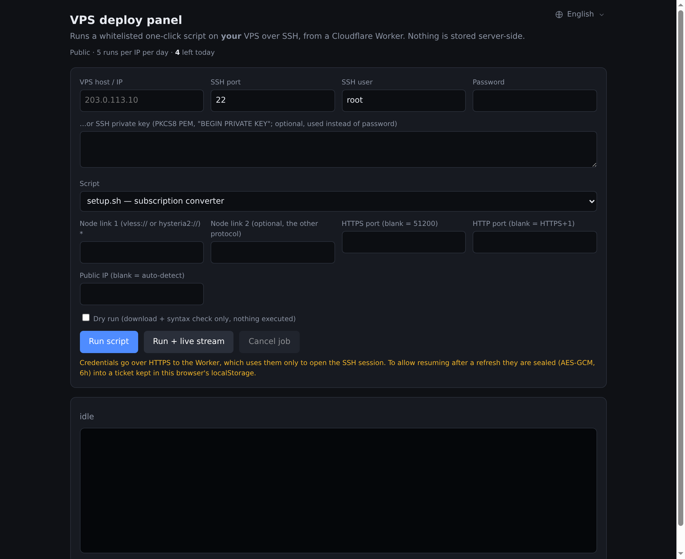

# VPS 部署面板（Cloudflare Worker）

浏览器里填一台 VPS 的 IP / 端口 / 账号，选一下要跑哪个脚本，点「运行」——
一个跑在 Cloudflare Workers 上的面板会 SSH 连过去，把仓库里的一键脚本丢上去执行，日志实时回显。

不用装客户端，不用在目标机上预先放东西，手机也能用。



> 官方实例：<https://deploy.notebase.cn>（公开模式，每个 IP 每天 5 次）

---

## 它能做什么

- **两个白名单脚本**：`hy2-bundle/hy2.sh`（VPS 一键部署，默认）与 `subconverter/setup.sh`（订阅转换），在「服务」下拉里切换
- **密码或私钥登录**：私钥走 PKCS8 PEM（`ssh-keygen -p -m PKCS8 -f key` 转换）
- **后台跑 + 断点续看**：任务在目标机 `detached` 运行，关掉页面不影响；刷新后还能接着看日志（票据 6 小时有效）
- **实时流**：`Run + live stream` 保持一个请求不断开，边跑边出
- **试运行**：只下载脚本 + `bash -n` 语法检查，什么都不执行；还会把脚本里会用到的交互提问按源码顺序列出来，方便抄进下面的答案框
- **参数是表单，不是盲填**：VPS 一键部署那套会直接列出脚本会问的字段（协议、端口、端口跳跃、节点名、连接方式、是否建用户…），填完自动按脚本的提问顺序喂给 stdin，不用自己猜第几行
- **自动认领结果**：从日志里挑出订阅链接，标出每条是干什么的（HTTP/HTTPS、`?mode=rules`、小火箭 `.conf`），一键复制；
  只选了「不要订阅链接」时，节点分享链接（`vless://` / `hysteria2://`）也会被认出来单独一行，不用去翻日志
- **中英双语**：默认英文，右上角下拉切中文，选择记在浏览器里

## 它是怎么处理你的密码的

- 账号密码只在**那一次请求**里使用，Worker 不落库、不写日志。
- 为了刷新页面还能续看任务，凭据会被 AES-GCM 加密成一个「票据」放在**你自己浏览器**的 localStorage，6 小时过期；解票据的密钥是 Worker 的 `TICKET_KEY`，不在票据里。
- 面板只能跑上面这两个脚本，不能执行任意命令。

## 部署（5 分钟）

要求：Cloudflare 账号 + Node 18+。

```bash
cd panel
npm install
npx wrangler deploy                      # 会自动创建 Durable Object（migration 已写在配置里）

npx wrangler secret put TICKET_KEY       # openssl rand -hex 32 —— 票据加密用，必填
npx wrangler secret put PANEL_TOKEN      # openssl rand -hex 16 —— 可选：主人钥匙
```

`wrangler.toml` 里 `name = "vps-deploy-panel"`，如果你账号里已经有同名 worker，改一下再部。

部署完打开输出的 `*.workers.dev` 地址即可。

**关于令牌**

| 模式 | 怎么配 | 效果 |
|---|---|---|
| 公开（默认） | `PUBLIC_MODE = "1"` | 谁都能用，每个 IP 每天 `DAILY_LIMIT` 次；全站每天 `GLOBAL_DAILY` 次封顶 |
| 私有 | `PUBLIC_MODE = "0"` | 必须填 `PANEL_TOKEN` 才能用 |
| 主人身份 | 打开 `https://你的域名/?t=<PANEL_TOKEN>` | 识别为部署者，**不占每日额度**（令牌存在那台浏览器里） |

额度计数在「参数校验通过、真正开始 SSH」时扣一次：填错参数不扣，连不上要扣（避免被拿去免费探测）。

## 配置项

| 变量 / 绑定 | 说明 |
|---|---|
| `PUBLIC_MODE` | `"1"` 公开免令牌，`"0"` 只认令牌 |
| `DAILY_LIMIT` | 每个 IP 每天的启动次数，默认 5（北京时间 0 点重置） |
| `GLOBAL_DAILY` | 全站每天总次数，默认 300 |
| `SETUP_URL` / `HY2_URL` | 覆盖两个脚本的下载地址 |
| `SCRIPT_BASE` | 一次性改脚本源（默认指向本仓库 raw） |
| `QUOTA`（DO 绑定） | 每日额度计数器，`wrangler deploy` 会自动创建 |
| `RL_API` / `RL_START` / `RL_AUTH` | 每分钟限流（按 IP） |

自定义域名（可选）：把 `wrangler.toml` 里的 `workers_dev` 和 `routes` 注释打开，域名所在 zone 必须在同一个 Cloudflare 账号下。

## 安全模型 / 已知限制

- 面板本身**不存任何凭据**，但它是一个能发 SSH 的出口：公开模式下任何人都能借你的 Worker IP 去连任意主机。介意这点就别开 `PUBLIC_MODE`，或者把 `GLOBAL_DAILY` 调小。
- **没有做 SSH host key 校验**（首连信任），介意中间人的话自己在 `sshOpts` 里加 `hostVerifier`。
- `sudo` 只支持免密（`sudo -n`）。
- 面板只允许这两个脚本，脚本地址在服务端固定；下载失败会明确报错，不会执行半截。
- 目标机上的临时文件在 `/tmp/dp-<job id>/`，任务结束不自动删（方便回头查）。

## 目录

```
panel/
├── src/index.js      # Worker：路由、SSH、脚本生成、额度、票据
├── src/page.html     # 单页前端（无构建、无依赖）
├── wrangler.toml
└── screenshot.png
```

MIT，随便改。
